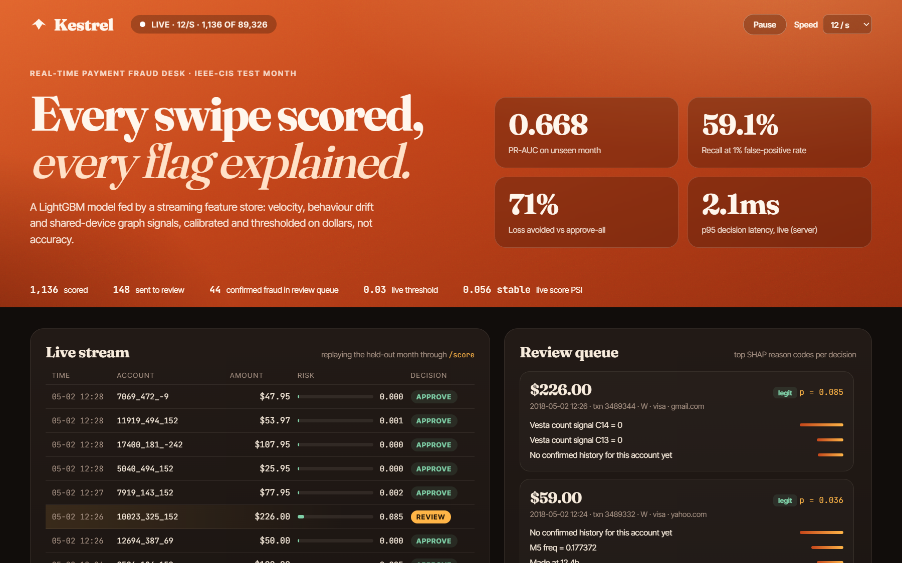
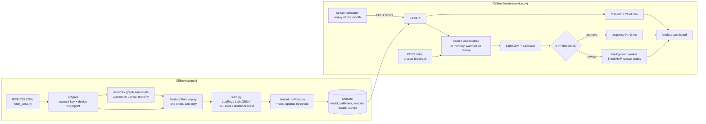
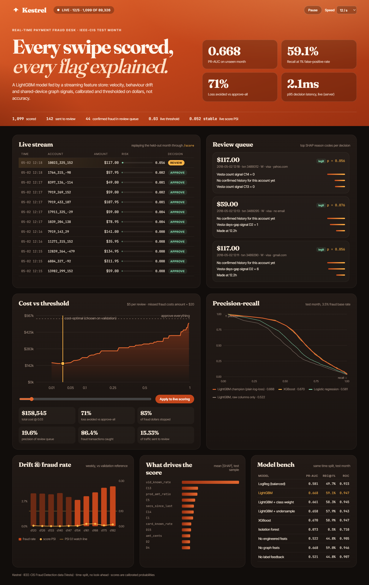

# Kestrel

**Real-time payment fraud detection on the IEEE-CIS dataset.** One streaming feature store serves both training and live scoring. On top of it: a LightGBM model calibrated to real probabilities, a review threshold chosen from a dollar cost matrix, and SHAP reason codes on every flagged case. A FastAPI service replays the held-out month, and an analyst dashboard shows it live.



| | |
|---|---|
| **Data** | IEEE-CIS Fraud Detection (Vesta): 590,540 card-not-present transactions, 3.5% fraud |
| **Split** | By time: fit on days 1–119, tune and calibrate on days 120–151, report once on days 152–182 |
| **Champion** | LightGBM, test **PR-AUC 0.668**, **59% recall at 1% false-positive rate** |
| **Money** | Loss on the test month falls from **$540k** (approve all) to **$117k**, a **78% cut** |
| **Latency** | Decision p95 **2.6 ms** in the server, **7.6 ms** over HTTP, 244 req/s on one laptop core |

## Architecture



**No train/serve skew.** Offline features come from replaying every transaction through `FeatureStore.process`, which the API also calls once per request. Each feature only ever sees the past plus the transaction being scored. `tests/test_features.py` proves this: features for the first *n* rows don't change when later rows are added.

## Features

IEEE-CIS has no customer id. Following common practice on this dataset, an account key is built from `card1 + addr1 + (day − D1)`, where the last part is the day the account was opened. A device fingerprint joins `DeviceInfo`, OS, browser, screen and two identity fields.

| Group | Features |
|---|---|
| Velocity | txn count per account in the last 1h / 24h / 7d / 30d; amount per account in 24h / 7d; card-range count and amount in 24h; device count in 24h; seconds since the account's last txn |
| Behaviour deviation | amount z-score and ratio against the account's own running mean (Welford); circular distance from the account's usual hour; new device for this account; new email domain; amount against the product-line average |
| Shared entities | distinct accounts on this device in 30 days; distinct accounts on this card range in 7 days; devices per account in 30 days |
| Graph (networkx) | monthly snapshots of the account–device graph: connected-component size, cards in the component, node degrees, confirmed-fraud accounts in the same component |
| Label feedback | earlier confirmed fraud on this account, device and card range. Labels only become visible **14 days** after the transaction, modelling chargeback and confirmation delay |
| Raw | amount, card / address fields, Vesta's C1–C14 and selected D columns, frequency-encoded categoricals (fitted on the training window only) |

Totals that keep growing over time (for example "accounts ever seen on this card") were replaced by windowed counts. In the first version they drifted 4–5x between the training and test months.

## Results (test month, days 152–182, 89,326 transactions)

| Model | PR-AUC | Recall @ 1% FPR | Recall @ 5% FPR | ROC-AUC | Brier (raw) |
|---|---:|---:|---:|---:|---:|
| Logistic regression (balanced weights) | 0.581 | 49.7% | 66.7% | 0.923 | 0.120 |
| **LightGBM, plain log-loss (champion)** | **0.668** | **59.1%** | 74.8% | 0.947 | 0.018 |
| LightGBM + class weights (×27) | 0.661 | 58.3% | 74.5% | 0.945 | 0.041 |
| LightGBM + undersampling to 1:5 | 0.658 | 57.9% | 74.3% | 0.943 | 0.026 |
| XGBoost (hist, CUDA) | 0.670 | 58.9% | 75.4% | 0.947 | 0.018 |
| Isolation forest (fit on legit only) | 0.073 | 0.5% | 13.9% | 0.710 | – |

**Ablations** (LightGBM, same settings):

| Feature set | PR-AUC | Recall @ 1% FPR |
|---|---:|---:|
| All features | 0.668 | 59.1% |
| Without graph and shared-entity features | 0.668 | 59.0% |
| Without delayed-label feedback | 0.521 | 44.8% |
| Raw columns only | 0.522 | 44.8% |

What the numbers say:

- **Accuracy is useless here.** Approving everything scores 96.5%. The tables use PR-AUC and recall at a fixed false-positive rate instead.
- **Imbalance handling didn't help ranking.** Class weights and undersampling both lowered PR-AUC slightly, and class weights more than doubled the Brier score because the probabilities get distorted. Plain log-loss plus calibration won.
- **The big lift is label feedback**, not velocity: +0.15 PR-AUC. Vesta's C and D columns already encode much of the velocity signal, so on their own the velocity and deviation features add little on top. Fraud in this data sticks to accounts, devices and card ranges, so "has this entity been confirmed bad before?" is the strongest real-time signal, even with a 14-day delay.
- **Graph features add nothing measurable here.** Only about 24% of transactions carry device identity. They are kept because they power the reason codes for device-ring cases, but the honest result is about 0.000 PR-AUC.
- **XGBoost ties LightGBM.** The champion is picked on validation PR-AUC among LightGBM variants, because native TreeSHAP gives exact reason codes at serving time.
- **The isolation forest fails as a detector** (PR-AUC 0.07). Fraud here doesn't look like an outlier; it looks like normal traffic from bad entities.

### Calibration and the threshold

Isotonic regression is fitted on the validation month. Test ECE drops from 0.0040 to 0.0026, and Brier stays at 0.0179.

Cost matrix: every review costs **$5**. A missed fraud costs **its amount + a $20 chargeback fee**.

| Decision rule (test month) | Total cost | Loss avoided | Review rate | Precision | Fraud caught | Fraud $ caught |
|---|---:|---:|---:|---:|---:|---:|
| Approve everything | $539,636 | – | 0% | – | 0% | 0% |
| Naive p ≥ 0.5 | $324,826 | 40% | 2.1% | 81.9% | 50.2% | 40.4% |
| Cost-optimal global threshold (p ≥ 0.03, chosen on validation) | $158,545 | 71% | 15.3% | 19.6% | 86.4% | 82.9% |
| **Amount-aware rule** p·(amount + $20) > $5 | **$117,239** | **78%** | 13.8% | 20.2% | 79.9% | 91.0% |

The amount-aware rule needs calibrated probabilities to work. It flags fewer transactions but catches more fraud dollars, because a $2,000 order at p = 0.01 is worth a look and a $3 one at p = 0.1 isn't. The dashboard slider replays the global-threshold trade-off on the test month.

### Explainability

TreeSHAP values come straight from LightGBM (`pred_contrib=True`). The top positive contributions are written as analyst-readable reasons, for example:

> 33% of this account's confirmed history was fraud · 2 earlier txns on this account confirmed as fraud · Amount is 2.0x the product line average

### Real-time scoring and latency

`scripts/replay.py --serve` sends 3,000 sequential requests from the test month to the API on localhost:

| | p50 | p95 | p99 |
|---|---:|---:|---:|
| Server decision path (features + model + calibration) | 1.2 ms | 2.6 ms | 3.7 ms |
| HTTP round trip | 3.7 ms | 7.6 ms | 9.9 ms |
| SHAP reason codes (background worker, flagged only) | – | 58 ms | – |

TreeSHAP over 1,316 trees takes about 29 ms on a single row. It runs off the authorization path: analysts get the reasons a moment later, and API callers can ask for them inline with `POST /score?explain=true`. At startup the feature store is warmed by replaying the 500k historical transactions (about 20 s), so rolling windows are live from the first request.

### Monitoring

Each week the service reports the score PSI against the validation-month reference, plus fraud rate, flag rate and queue precision. The PSI of the live stream is recomputed as it runs. Over the test month PSI stays below 0.02 (stable), while the fraud rate moves between 2.9% and 4.3%.



## Run it

Needs Python 3.10+ and about 2 GB of free RAM. No GPU is required; XGBoost uses CUDA when it's there.

```bash
pip install -r requirements.txt
python scripts/fetch_data.py        # ~710 MB IEEE-CIS train files into data/raw (not committed)
python scripts/build_features.py    # replay through the feature store, ~1 min
python scripts/train.py             # all models, calibration, threshold, ablations (resumable)
uvicorn kestrel.service:app --port 8000
# open http://localhost:8000  (add ?still to turn off motion)
python scripts/replay.py --serve --url http://127.0.0.1:8001   # latency benchmark
```

The data comes from a public Hugging Face mirror of the Kaggle competition files, so no Kaggle login is needed. It is used under the competition's terms and never stored in this repo.

### API

| Method | Path | |
|---|---|---|
| POST | `/score` | Score one raw transaction (`?explain=true` for inline reason codes) |
| POST | `/label` | Analyst feedback for a scored transaction; feeds the known-fraud features |
| GET | `/api/feed`, `/api/flagged` | Live stream and review queue |
| GET | `/api/summary`, `/api/curves`, `/api/monitoring`, `/api/latency` | Results, PR and cost curves, drift, latency |
| POST | `/api/threshold`, `/api/replay/start`, `/api/replay/stop` | Live controls |

## Tests and CI

`pytest` runs 17 tests on a small synthetic frame with the IEEE-CIS schema (random data, not a sample of the real set). They cover window expiry, velocity counts, no look-ahead, label-delay causality, graph snapshots that only use past edges, online and offline key parity, the cost curve against direct cost, PSI, reason codes, and an end-to-end train-then-serve run through the FastAPI app. GitHub Actions runs them on every push.

## Layout

```
kestrel/   data.py  features.py  graph.py  matrix.py  train.py  metrics.py
           explain.py  monitor.py  service.py
scripts/   fetch_data.py  build_features.py  train.py  replay.py
dashboard/ index.html  styles.css  app.js      (no build step)
tests/
```

## Limits

- The account key is a reconstruction, not a real customer id, and Vesta's columns are anonymised. Some reason codes can only say "Vesta count signal C13".
- The 14-day label delay is an assumption. Real chargebacks can take 30–90 days, which would weaken the feedback features.
- Hyper-parameters were not tuned. Early stopping uses the validation month, which is also used for calibration and threshold choice. The test month is touched once.

---

<sub>One of thirteen projects by [Alok Kulkarni](https://alok.is-a.dev): [Hearth](https://github.com/alok-kul5/hearth-iot) home sensors · [Headway](https://github.com/alok-kul5/headway-transit) transit data · [Vigil](https://github.com/alok-kul5/vigil-soc) security triage · [Loupe](https://github.com/alok-kul5/loupe-vision) defect inspection · [Kharcha](https://github.com/alok-kul5/kharcha-finance) personal finance · [Stockroom](https://github.com/alok-kul5/stockroom-inventory) inventory · [Quietwire](https://github.com/alok-kul5/quietwire-villa) smart home design · [Canopy](https://alok.is-a.dev/canopy/) coffee storefront · [Picket](https://github.com/alok-kul5/picket) detection rules · [Warden](https://github.com/alok-kul5/warden-iac) cloud IaC scanning · [Marquee](https://github.com/alok-kul5/marquee-recs) recommendations · **Kestrel** fraud detection · [Almanac](https://github.com/alok-kul5/almanac-forecast) demand forecasting.</sub>
